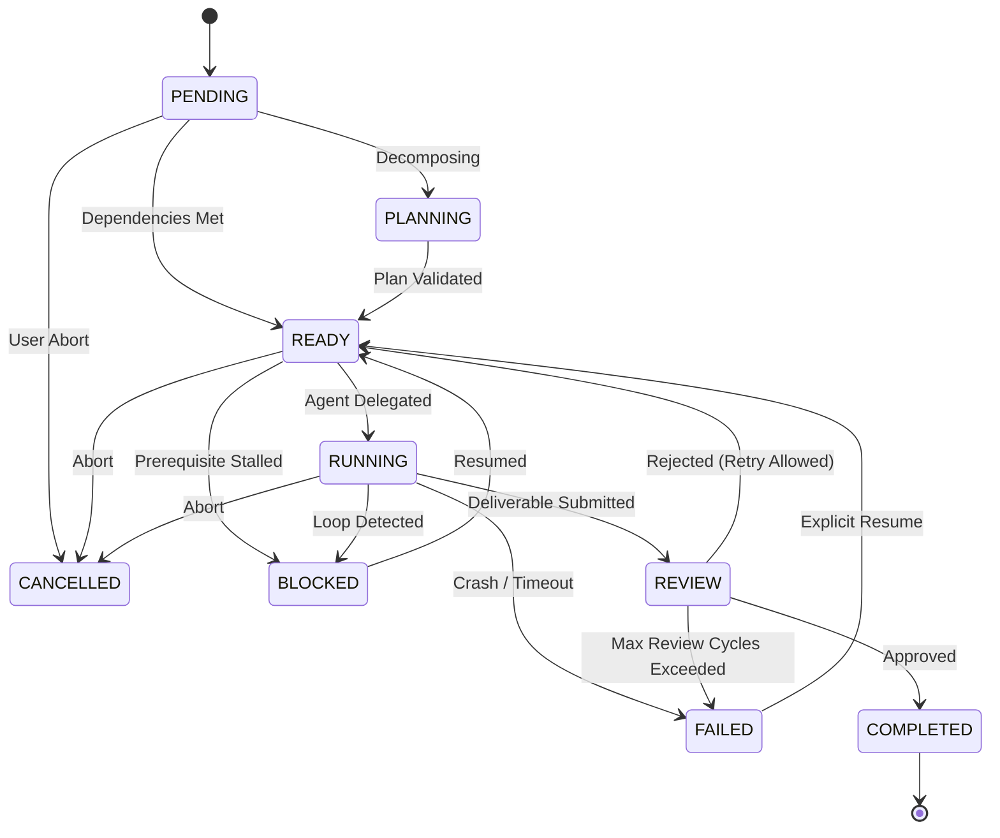

# Arquitectura de Argon Bridge v1.0.0

## 1. Visión General

Argon Bridge conecta de forma desacoplada dos mundos:
1. **El Cerebro Estratégico (Argon / Gemini Web):** Proporciona razonamiento arquitectónico de alto nivel, descomposición funcional, evaluación de riesgos y diseño de sistemas.
2. **El Entorno de Ejecución (Google Antigravity):** Ejecuta código, pruebas, manipulación de archivos y coordinación de subagentes en el entorno local.

---

## 2. Diagrama de Arquitectura de Capas

```
+-------------------------------------------------------------------+
|                        GEMINI WEB BROWSER                         |
|                     (gemini.google.com)                           |
+-------------------------------------------------------------------+
                                  │
                   User-Assisted Click / Clipboard
                                  │
                                  ▼
+-------------------------------------------------------------------+
|               ARGON EXTENSION (Manifest V3)                       |
|   - Content Script: gemini-bridge.js (Floating UI)                |
|   - Popup: Control panel, Project & Task switcher                 |
|   - Background Service Worker: chrome.runtime.connectNative       |
+-------------------------------------------------------------------+
                                  │
                       Chrome Native Messaging
                       (4-byte LE length + JSON)
                                  │
                                  ▼
+-------------------------------------------------------------------+
|                   ARGON NATIVE HOST & CORE                        |
|   - Binary stdio parser                                           |
|   - Origin checking & size validation (<1MB)                      |
|   - IPC bridge to Storage & TaskEngine                            |
+-------------------------------------------------------------------+
          │                                           │
          │ Local Repository                          │ MCP Protocol (stdio)
          ▼                                           ▼
+-------------------------+               +-------------------------+
|     ARGON STORAGE       |               |        ARGON MCP        |
|  - SQLite (node:sqlite) |               |  - Official MCP SDK     |
|  - Schema Migrations    |               |  - 14 Standard Tools    |
|  - Projects & Tasks     |               |  - Resources & Prompts  |
|  - Project Memory       |               +-------------------------+
|  - Executions & Reviews |                            │
+-------------------------+                            │
          ▲                                            ▼
          │                               +-------------------------+
+-------------------------+               |    GOOGLE ANTIGRAVITY   |
|    ARGON SUPERVISOR     |               |   - Agent Orchestrator  |
|  - Loop Detector        |<──────────────|   - Multi-Agent Workers |
|  - Criteria Evaluator   |               |   - Workspace Execution |
|  - Timeout & Retries    |               +-------------------------+
+-------------------------+
```

---

## 3. Modelo de Estados de Tareas

Las tareas atraviesan una máquina de estados finitos determinista:



---

## 4. Estructura de Paquetes y Módulos

- `src/core/types.ts`: Esquemas Zod y contratos de datos inmutables.
- `src/core/state-machine.ts`: Validador de transiciones válidas.
- `src/core/dag.ts`: Orden topológico y detección de ciclos circulares.
- `src/core/task-engine.ts`: Orquestador del ciclo de vida de tareas y proyectos.
- `src/core/project-memory.ts`: Almacenamiento estructurado de decisiones y prevención de errores repetitivos.
- `src/storage/db.ts`: Conexión de base de datos SQLite con `node:sqlite`.
- `src/storage/repository.ts`: Repositorio con consultas SQL tipadas y soporte para transacciones.
- `src/supervisor/supervisor.ts`: Supervisor de agentes que vigila el progreso.
- `src/supervisor/loop-detector.ts`: Algoritmo de hash y similitud Jaccard para frenar ciclos repetitivos.
- `src/mcp/server.ts`: Servidor MCP oficial stdio para Antigravity.
- `src/native-host/host.ts`: Host binario para Chrome Native Messaging.
